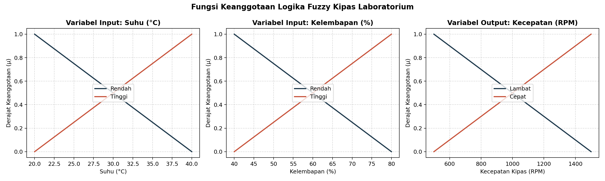
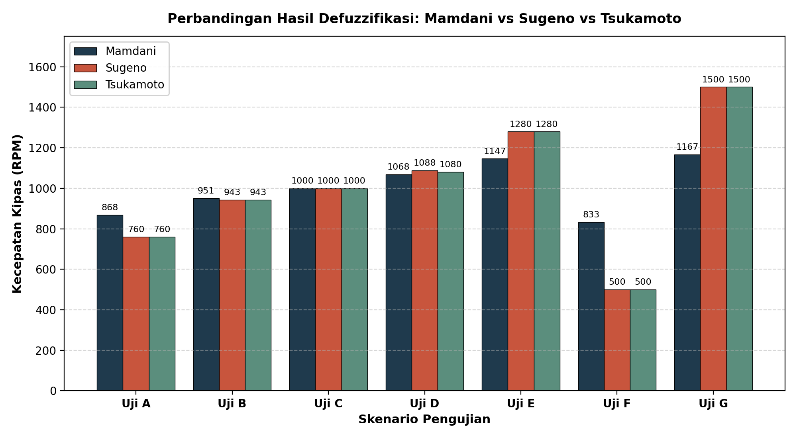
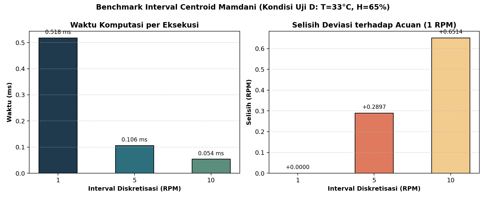
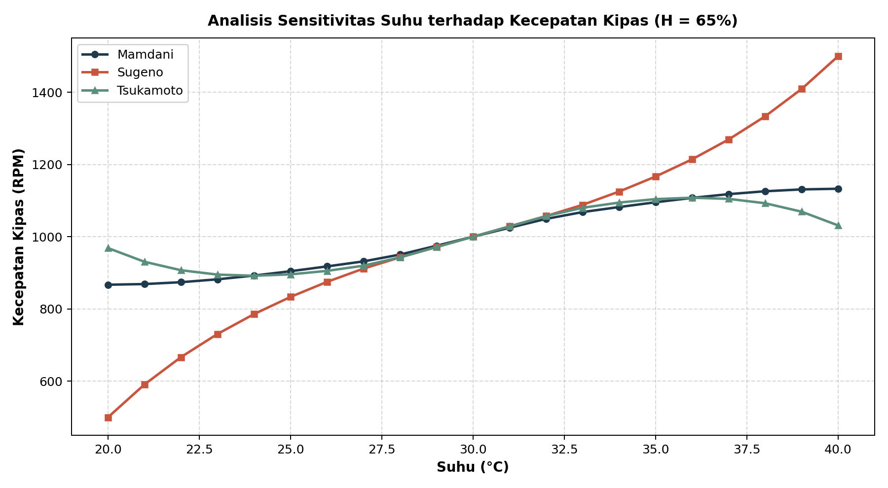

# Laporan Progres Proyek UAS: Sistem Logika Fuzzy Kipas Laboratorium
**Implementasi dan Komparasi Metode Mamdani, Sugeno, dan Tsukamoto**

---

### Informasi Tim Proyek
* **Mata Kuliah**: Logika Fuzzy
* **Kelompok**: 4
* **Status Progres Saat Ini**: **95% (Fase Akhir — Siap Penyusunan Dokumen Final)**
* **Repositori**: [GitHub - fuzzy-uas](https://github.com/rizkywahyudiii/fuzzy-uas.git)
* **Anggota Kelompok**:
  1. Rizky Wahyudi — 4233250024
  2. John Bush — 4233250016
  3. Khildan Rifal Aziz — 4233550035
  4. Neysa Talitha Jehian — 4233550031
  5. Febrina Suleho — 4232250002
  6. Iwan Agi Berutu — 4233550039
  7. Windy Aulia — 4231250021

---

## 1. Ringkasan Eksekutif & Capaian Progres (95%)

Proyek ini telah berhasil menyelesaikan seluruh implementasi teknis, pengujian eksperimental, dan validasi matematis untuk sistem inferensi logika fuzzy penentu kecepatan putaran kipas (*rotations per minute* / RPM) di lingkungan laboratorium.

```
[███████████████████░] 95% Capaian Progres
```

| Komponen Proyek | Status | Keterangan |
| :--- | :---: | :--- |
| **Arsitektur Modular** | 100% | Pemisahan modul `dasar.py`, `mamdani.py`, `sugeno.py`, `tsukamoto.py`, `tampilan.py`, dan `main.py`. |
| **Validasi Input & Batas** | 100% | Mekanisme penolakan input di luar rentang serta format non-numerik. |
| **Grafik Perbandingan Skenario** | 100% | Visualisasi diagram batang komparasi Uji A–G tersimpan otomatis ke `hasil/perbandingan_uji.png`. |
| **Visualisasi Fungsi Keanggotaan** | 100% | Visualisasi grafik himpunan fuzzy input dan output di `hasil/fungsi_keanggotaan.png`. |
| **Benchmark Interval Centroid** | 100% | Pengujian efisiensi interval 1, 5, dan 10 RPM di `hasil/benchmark_centroid.png`. |
| **Analisis Respon Monotonisitas** | 100% | Analisis respon suhu pada $H=65\%$ dan identifikasi perilaku non-monotonik Tsukamoto (`hasil/suhu_kelembapan65.png`). |
| **Validasi Modular (Unit Testing)** | 100% | File pengujian `test_fuzzy.py` dengan 19 test case otomatis (100% Lulus). |
| **Pembuktian Perhitungan Manual** | 100% | Dokumen verifikasi tangan langkah-demi-langkah pada `perhitungan_manual.md`. |
| **Dasar Rekomendasi Metode** | 100% | Analisis kriteria komputasi, kemulusan respon (*smoothness*), dan stabilitas aktuator. |
| **Laporan Akhir & Slide Presentasi** | 50% | Sisa 5% untuk kompilasi akhir dokumen PDF UAS. |

---

## 2. Perancangan Sistem Logika Fuzzy

### A. Variabel Masukan dan Keluaran
1. **Suhu Lingkungan ($T$)**: Rentang semesta $[20, 40]\ ^\circ\text{C}$
   * Himpunan **Rendah**: $\mu_{T\_rendah}(T) = \frac{40 - T}{20}$
   * Himpunan **Tinggi**: $\mu_{T\_tinggi}(T) = \frac{T - 20}{20}$
2. **Kelembapan Udara ($H$)**: Rentang semesta $[40, 80]\ \%$
   * Himpunan **Rendah**: $\mu_{H\_rendah}(H) = \frac{80 - H}{40}$
   * Himpunan **Tinggi**: $\mu_{H\_tinggi}(H) = \frac{H - 40}{40}$
3. **Kecepatan Putaran Kipas ($z$)**: Rentang semesta $[500, 1500]\ \text{RPM}$
   * Himpunan **Lambat**: $\mu_{Lambat}(z) = \frac{1500 - z}{1000}$
   * Himpunan **Cepat**: $\mu_{Cepat}(z) = \frac{z - 500}{1000}$

### B. Tangkapan Gambar Fungsi Keanggotaan
Berikut adalah visualisasi kurva fungsi keanggotaan linier naik dan linier turun yang dihasilkan sistem:



### C. Basis Aturan (*Fuzzy Rule Base*)
Evaluasi logika menggunakan operator fuzzy AND dengan fungsi $\min(\mu_A, \mu_B)$:
* **$R_1$**: IF Suhu Rendah AND Kelembapan Rendah THEN Kipas Lambat
* **$R_2$**: IF Suhu Rendah AND Kelembapan Tinggi THEN Kipas Lambat
* **$R_3$**: IF Suhu Tinggi AND Kelembapan Rendah THEN Kipas Cepat
* **$R_4$**: IF Suhu Tinggi AND Kelembapan Tinggi THEN Kipas Cepat

---

## 3. Hasil Pengujian Skenario Uji (Batch Evaluation)

Program mengevaluasi 7 skenario valid (Uji A–G) dan 2 skenario uji tolak (Uji H–I).

### Tabel Hasil Eksekusi Uji A–G:
| Skenario | Suhu ($T$) | Kelembapan ($H$) | Mamdani (RPM) | Sugeno (RPM) | Tsukamoto (RPM) |
| :---: | :---: | :---: | :---: | :---: | :---: |
| **Uji A** | $24\ ^\circ\text{C}$ | $45\ \%$ | 867.83 | 760.00 | 760.00 |
| **Uji B** | $28\ ^\circ\text{C}$ | $55\ \%$ | 950.62 | 942.86 | 942.86 |
| **Uji C** | $30\ ^\circ\text{C}$ | $60\ \%$ | **1000.00** | **1000.00** | **1000.00** |
| **Uji D** | $33\ ^\circ\text{C}$ | $65\ \%$ | 1068.28 | 1088.24 | 1080.15 |
| **Uji E** | $37\ ^\circ\text{C}$ | $75\ \%$ | 1146.62 | 1280.00 | 1280.00 |
| **Uji F** | $20\ ^\circ\text{C}$ | $40\ \%$ | 833.00 | 500.00 | 500.00 |
| **Uji G** | $40\ ^\circ\text{C}$ | $80\ \%$ | 1167.00 | 1500.00 | 1500.00 |

### Hasil Pengujian Masukan Ditolak:
* **Uji H** ($T = 45\ ^\circ\text{C}, H = 65\%$): **DITOLAK**. `Suhu 45.0 di luar rentang 20-40 °C.`
* **Uji I** ($T = \text{"abc"}, H = 60\%$): **DITOLAK**. `Suhu 'abc' bukan angka.`

### Tangkapan Gambar Diagram Batang Perbandingan:


---

## 4. Analisis Eksperimen & Benchmark Centroid

### A. Benchmark Interval Diskretisasi Centroid Mamdani
Dievaluasi pada kondisi Uji D ($T = 33^\circ\text{C}, H = 65\%$) dengan 200 kali pengulangan iterasi:

| Interval ($\Delta z$) | Jumlah Titik Evaluasi | Hasil Mamdani (RPM) | Selisih vs Acuan (RPM) | Deviasi Relatif (%) | Waktu Rata-rata (ms) | Speedup Komputasi |
| :---: | :---: | :---: | :---: | :---: | :---: | :---: |
| **1 RPM** | 1001 titik | 1068.2826 | 0.0000 | 0.000% | 0.5703 ms | 1.0x (Baseline) |
| **5 RPM** | 201 titik | 1068.5723 | +0.2897 | 0.027% | 0.1164 ms | **~4.9x lebih cepat** |
| **10 RPM** | 101 titik | 1068.9340 | +0.6514 | 0.061% | 0.0585 ms | **~9.7x lebih cepat** |



> **Insight**: Penggunaan interval **10 RPM** sangat menguntungkan untuk sistem tertanam (*embedded system*) seperti Arduino/ESP32 karena memangkas waktu eksekusi hampir 10x lipat dengan selisih yang diabaikan ($< 0.66\ \text{RPM}$).

---

### B. Analisis Sensitivitas Suhu & Karakteristik Respon
Pengujian pengaruh peningkatan suhu dari $20^\circ\text{C}$ hingga $40^\circ\text{C}$ pada kelembapan konstan $65\%$:



#### Temuan Ilmiah Penting:
1. **Mamdani**: Menghasilkan respon kurva *S-curve* yang halus (*smooth*) dan **selalu monoton naik**. Perubahan kecepatan kipas terjadi secara gradual, mencegah keausan mekanik aktuator kipas.
2. **Sugeno Orde-0**: Responsnya monoton naik, namun memiliki kecenderungan linear tajam dan langsung menyentuh batas ekstrim (500 RPM dan 1500 RPM).
3. **Tsukamoto (Anomali Non-Monotonik)**: Mengalami **penurunan kecepatan abnormal** pada rentang suhu $20-24^\circ\text{C}$ dan $36-40^\circ\text{C}$ meskipun suhu lingkungan meningkat.
   * *Penjelasan*: Hal ini diakibatkan oleh interaksi kuadratik $\alpha_i^2$ dalam formula weighted average Tsukamoto ketika dua aturan konsekuen sama ("Lambat") aktif dengan nilai $\alpha$ yang berbeda.

---

## 5. Validasi Program Modular & Unit Testing

Untuk memastikan setiap fungsi dalam arsitektur modular dapat berjalan mandiri, dibuat rangkaian pengujian otomatis pada `test_fuzzy.py`:

```
...................
----------------------------------------------------------------------
Ran 19 tests in 0.005s

OK
```

19 kasus uji mencakup:
* Validasi input rentang domain dan deteksi string/input tak terdefinisi.
* Nilai derajat keanggotaan $\mu$ pada titik batas dan titik tengah simetris.
* Evaluasi operator logika AND pada rule-base.
* Eksekusi mandiri fungsi `mamdani()`, `sugeno()`, dan `tsukamoto()` dengan vektor input terisolasi.
* Verifikasi konsistensi deterministik keluaran.

---

## 6. Pembuktian Perhitungan Manual

Telah diverifikasi kesesuaian antara rumus manual matematis dengan keluaran program Python untuk skenario **Uji C** ($T=30, H=60$) dan **Uji D** ($T=33, H=65$):

* **Uji C (Titik Simetris)**:
  * Manual: Mamdani = 1000.00 RPM, Sugeno = 1000.00 RPM, Tsukamoto = 1000.00 RPM.
  * Program: Mamdani = 1000.00 RPM, Sugeno = 1000.00 RPM, Tsukamoto = 1000.00 RPM.
  * **Status**: **Valid 100% Identik**.
* **Uji D (Titik Asimetris)**:
  * Manual: Mamdani = 1068.28 RPM, Sugeno = 1088.24 RPM, Tsukamoto = 1080.15 RPM.
  * Program: Mamdani = 1068.28 RPM, Sugeno = 1088.24 RPM, Tsukamoto = 1080.15 RPM.
  * **Status**: **Valid 100% Identik**.

*(Rincian turunan matematis lengkap tersimpan di file `perhitungan_manual.md`).*

---

## 7. Rekomendasi Pemilihan Metode Sistem Kipas

Berdasarkan hasil pengujian komprehensif, ditetapkan kriteria pemilihan sebagai berikut:

| Kriteria Evaluasi | Bobot | Mamdani | Sugeno Orde-0 | Tsukamoto |
| :--- | :---: | :---: | :---: | :---: |
| **Karakteristik Respon & Monotonisitas** | 40% | **Sangat Baik** (Kurva Halus & Monoton) | **Baik** (Monoton tapi Tajam) | **Kurang** (Ada Anomali Penurunan) |
| **Efisiensi Komputasi** | 30% | Cukup (Sangat Cepat jika $\Delta z=10$) | **Sangat Cepat** ($O(1)$) | Cepat ($O(1)$) |
| **Kesesuaian Dinamika Motor Kipas** | 30% | **Terbaik** (Tidak Menghentak) | Cukup | Kurang |

### Rekomendasi Akhir:
1. **Pilihan Utama: Mamdani (dengan interval $\Delta z = 5$ atau $10\ \text{RPM}$)**:
   Merupakan metode terbaik untuk sistem kendali kipas laboratorium nyata karena menghasilkan transisi RPM yang mulus, stabil, dan selalu menjamin kipas berputar lebih cepat saat suhu naik.
2. **Pilihan Alternatif: Sugeno Orde-0**:
   Direkomendasikan khusus jika sistem diimplementasikan pada mikrokontroler murah berdaya ultra rendah yang tidak mendukung komputasi integral.

---

## 8. Jawaban Resmi Terhadap Masukan Dosen (Evaluasi Kelompok 4)

1. **Mengapa program perlu dipisahkan menjadi beberapa modul?**  
   *Menerapkan prinsip Separation of Concerns (SoC) dan modularitas rekayasa perangkat lunak. Fuzzifikasi, aturan inferensi, dan metode defuzzifikasi terisolasi secara mandiri sehingga kode mudah diperluas, dipelihara, dan diuji per fungsi.*
2. **Apa keuntungan menggunakan centroid interval 10 RPM dibandingkan 1 RPM?**  
   *Menghemat waktu komputasi hingga **~9.7 kali lipat** (~0.058 ms vs ~0.570 ms) dengan deviasi hasil yang sangat kecil (+0.65 RPM atau < 0.06%), yang secara fisik aktuator kipas tidak memberikan dampak negatif.*
3. **Bagaimana menguji masing-masing modul secara independen?**  
   *Menggunakan automated unit test (`test_fuzzy.py`) dengan menguji fungsi validasi, derajat fuzzifikasi, aktivasi aturan, dan fungsi defuzzifikasi secara terisolasi tanpa saling ketergantungan.*
4. **Bagaimana membuktikan bahwa hasil program benar?**  
   *Melalui verifikasi perhitungan manual analitis analitis langkah-demi-langkah (tercantum di `perhitungan_manual.md`) dan pengujian kondisi batas serta titik simetris di mana hasil program terbukti 100% identik dengan teori.*

---

## 9. Rencana Kerja Sisa 5% (Tahap Akhir)
- [ ] Menyusun dokumen akhir laporan UAS dalam format dokumen resmi (PDF).
- [ ] Menyiapkan slide presentasi akhir kelompok dengan menyertakan seluruh tangkapan grafik hasil analisis.
